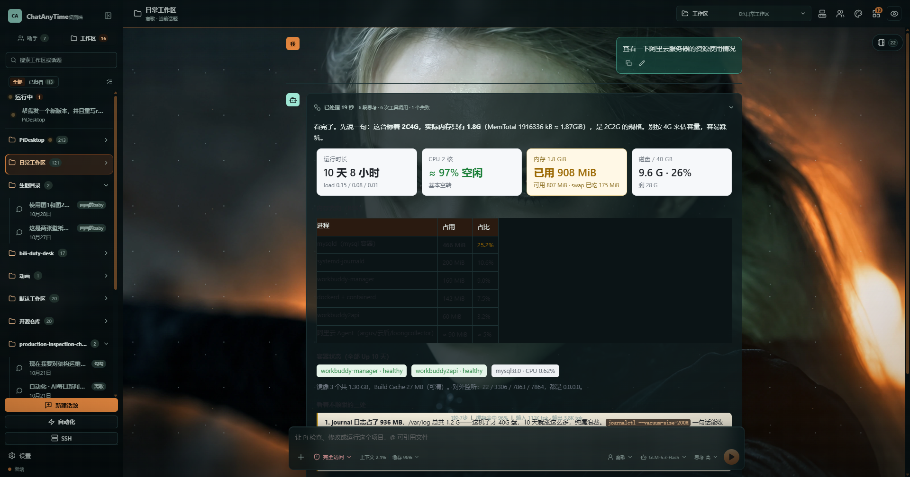
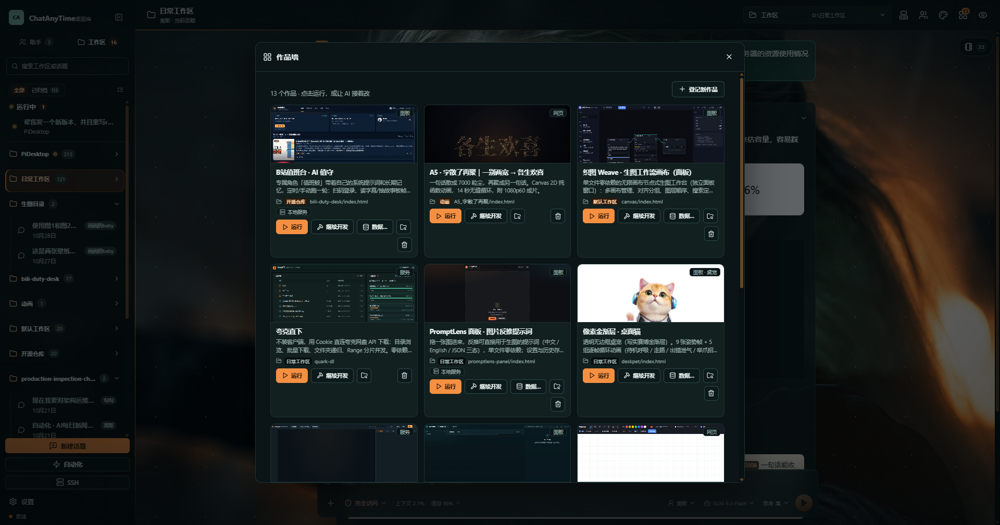
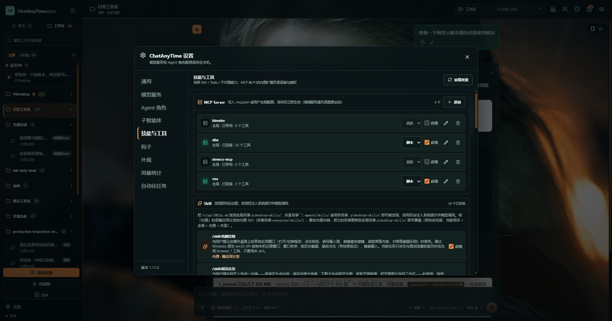
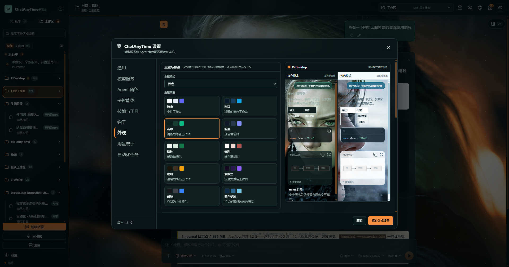
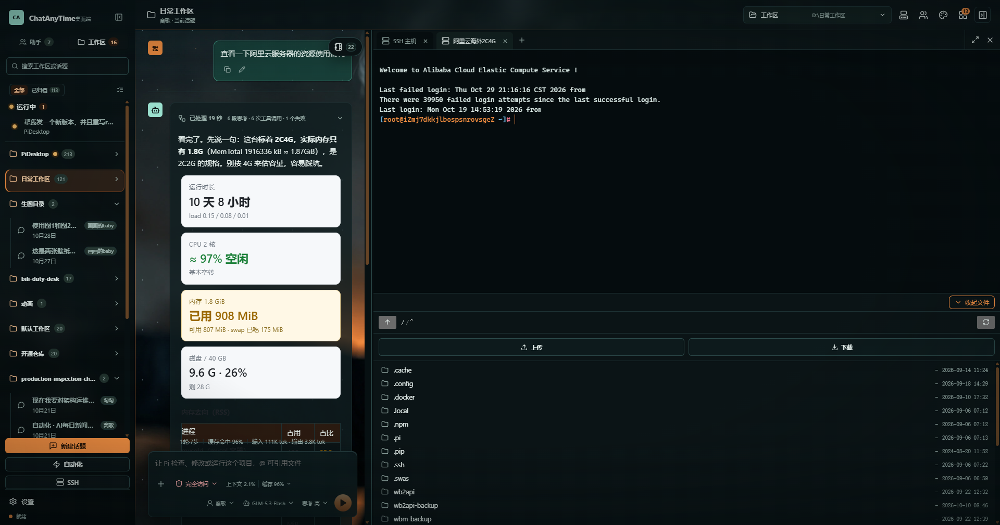

# ChatAnyTime

[](https://github.com/LuckyLXX/chat-anytime/releases/latest)
[](#安装)
[](LICENSE)

ChatAnyTime 是一个面向项目开发的桌面 AI 客户端。它以 Pi 的 Agent 运行时（模型、会话、工具、上下文管理）为底座，重新实现桌面交互，围绕「读代码 → 改文件 → 跑命令 → 验证 → 记录」这条真实开发回路设计界面：工具调用逐条可见、可中断，改动有 Diff 与回滚，做出来的成果能沉淀成作品或定时任务。



> 侧栏按工作区组织话题，顶部「运行中」跨工作区汇总正在执行的会话；中间是带工具时间线与可交互卡片的对话；右侧可停靠预览面板（内置浏览器 / 终端 / SSH / 文件）。截图使用自定义主题「霜焰」，应用内可在 10 套内置预设与自己的 CSS 之间切换。

## 界面预览

| 作品墙 | 能力管理 |
| --- | --- |
|  |  |
| AI 做出来的成果登记成作品：`file` / `server` / `panel` 三种形态，每个作品都有封面，可一键运行或让 AI 接着改 | MCP 服务器（stdio / HTTP、OAuth、热生效）与技能清单；子智能体、命令、钩子与长期记忆也在同一处管理 |

| 主题与外观 | SSH 远程 |
| --- | --- |
|  |  |
| 明暗双模式语义变量、10 套预设、实时预览；也可导入整份 CSS 或主题目录（壁纸与字体随目录走） | 主机与分组、指纹信任、远端 PTY 终端，以及同一区域的远端文件面板（上传 / 下载 / 进度 / 取消） |

## 快速开始

### 安装

从 [Releases](https://github.com/LuckyLXX/chat-anytime/releases/latest) 下载 `ChatAnyTime Setup <版本>.exe`（Windows x64），双击安装即可。

- 建议先确认系统装有 **VC++ 2015-2022 x64 Redistributable**：缺它时终端、剪贴板相关功能会提示缺少 `VCRUNTIME140.dll`
- 安装包由 GitHub Actions 在打 tag 时构建：干净 `npm ci` → `npm test` → `electron-builder` → 静态校验（`verify-package`），全绿才上传 Release
- 尚无自动更新与代码签名，升级请手动下载新版本覆盖安装；用户数据在 `%APPDATA%\chat-anytime`，覆盖安装不受影响

### 从源码运行

需要 Node.js `>= 22.19.0`（Electron 43 自带的运行时满足 Pi 的要求）。

```bash
npm install
npm run dev
```

测试与构建：

```bash
npm test        # vitest（约 280 个文件 / 3100+ 用例）
npm run build   # 两套 tsc --noEmit + electron-vite build
```

打包（也可以交给 CI）：

```bash
npm run package:win         # dist/win-unpacked/ChatAnyTime.exe（需整目录一起分发）
npm run package:installer   # dist/ChatAnyTime Setup <版本>.exe
```

## 当前能力

### 工作区与话题

- **工作区优先**：侧栏以工作区为主轴组织话题；每个助手记住自己最后用的工作区，另有「默认工作区」兜底，目录被删/移走的会话只读并在列表里标注
- **运行中分区**：分组默认折叠，正在执行的会话会跨工作区汇总到侧栏顶部（分组标题另有运行点、侧栏按钮带计数），点一下就切过去
- 多会话并行：切走的会话在后台继续跑，侧栏四色状态点提示「运行中 / 已完成 / 失败 / 已中止」，回到会话即清零
- 话题管理：置顶、重命名、软归档（「全部 / 已归档」双屏）+ 多选批量归档 / 恢复 / 删除
- 分屏：最多 4 格，每格独立的输入框、草稿、模型、思考级别与权限，拖动分隔条调比例
- 命令面板（`Ctrl+K`）：搜索动作与最近工作区；输入任意文字后，列表最后一行的「搜索会话内容」进入两段式全文检索，回车直接定位到那条消息
- 长会话：轮次缩略导航 + 视口窗口化渲染；输入框随内容自增高（到 240px 后改为内部滚动）

### 模型与 Agent

- 配置多个 OpenAI 兼容中转站，拉取上游模型列表，并可逐个覆盖「是否支持图片输入」
- 输入区快捷切换模型与思考级别；状态行实时显示上下文占用与流式 `~N tok/s`
- Agent 角色：人格与系统提示词、技能勾选、内建工具开关；会话与长期记忆均按助手隔离
- 子代理：`delegate_agent` 单层委派，内置「代码审查 / 项目探索 / 通用」三类角色（前两者只读，通用可用内置浏览器验证页面），也可自定义系统提示、模型、思考等级与工具集；执行过程在侧栏以嵌套事件流呈现
- 团队模式：给会话配上常驻成员，成员之间可以互发消息、共享任务板，顶栏进入团队看板与编队图
- 设计模式：对话旁展开画布工作台，AI 用 `design_*` 工具维护设计文档（`.design.json`）并导出 HTML
- 图片识别兜底：对话模型不支持图片输入时，附件自动交给指定的多模态模型识别；模型也能用 `recognize_images` 读工作区里的图片文件

### 工具与执行

- Pi 原生工具（`read` / `bash` / `edit` / `write` / `grep` / `find` / `ls`，另有可选开启的 Windows 原生 `powershell`），参数、输出与文件 Diff 全程流式展示
- 可中断执行：任务面板里能单独停掉某条 shell 命令，进程树被清理但本轮回复继续
- 代码模式（codemode）：一次调用里写一段沙箱脚本批量调用其它工具（并行读多文件、批量统计、大输出预筛），脚本内的工具调用同样走权限与审计；MCP 服务器的工具可选「直连 / 脚本」两种暴露方式，脚本模式不占每轮前缀
- 权限四档：只读 / 每次询问 / 工作区访问 / 完全访问；「本会话允许」按 `工具:风险` 组合记忆，不会让普通写入授权顺带放开工作区外写入
- 计划模式：先出计划、经你审批后实施，批准的计划留档 `docs/plans/`，也可以整体移交给新会话执行
- Checkpoint 回滚：AI 每次写文件前即时快照，交付物行内一键恢复到回复前状态
- 任务清单：`todo_write` 整表替换维护清单，右上角任务面板随会话切换、只读实时展示
- 电脑控制：`computer_*` 枚举本机窗口、后台截图、点击（带命中与前台校验）与键盘输入，可以操作其它桌面应用
- 自动化任务：cron 周期或一次性延时触发，可投递回当前会话、也可在后台新会话执行；任务可指定工作区，运行记录可回看

### 富内容与预览

- 流式 Markdown / GFM / 代码高亮 / KaTeX / Mermaid，思考过程与工具调用分轮折叠
- 代码高亮认语言标注（`language-x` / `hljs-x` / 裸类名等，含别名归一），完全没标注时只做零误判兜底（`$ ` 提示符、`PS C:\`、可 `JSON.parse`、`@@` diff 等），散文与日志保持纯文本
- **Div 气泡**：助手可以整条回答输出一页 HTML 卡片，在聊天窗口内直接渲染——按钮、Canvas、计时器、折叠都能用，脚本跑在受控作用域里；卡片内支持图片、`<video>` / `<audio>` 播放工作区里的 mp4 / webm / mp3（可拖动进度）
- HTML/SVG Artifact 在无同源权限的 sandbox iframe 中预览；Markdown 预览带文档大纲、多标签与全屏；侧栏直接打开 HTML 也会注入 `base href`，相对图片与样式照常加载
- 附件：回形针、粘贴、拖拽添加图片或工作区文件；回复可一键分享为长图（回复里有气泡时只截气泡）
- 图片请求体积治理：入模型前按字节预算压缩历史图片并留占位符，避免撞上上游网关的请求体上限

### 内置浏览器、终端与 SSH

- 预览面板里的完整浏览器：标签页、地址栏、前进/后退/刷新、书签、人工下载的「保存 / 另存为」决策；空闲标签会休眠回收
- 15 个 `browser_*` 自动化工具（导航 / 快照 / 点击 / 输入 / 按键 / 滚动 / 下拉 / 上传 / 求值 / 截图 / 整页截图 / 等待 / 取文本 / 标签页管理 / 页面图片直存工作区）；`navigate` 与写模式 `eval` 走同一权限闸口，操作期间页面顶部有横幅提示
- 手动元素选取：预览工具栏的准星进入选取模式，点击页面元素即把「来自内置浏览器」的上下文块填进输入框
- Jev（TypeSafe）快速决策通路（可选开启）：只给一个目标，由外部模型逐步挑选操作与目标，工具侧只暴露观察 / 执行 / 重置三个原语，并带步数预算与敏感页面刹车
- 终端面板：主进程 node-pty + xterm.js 的真实 shell，独立于 AI 的 `bash` 工具
- SSH 面板：主机与分组管理、指纹信任（TOFU）、远端 PTY 终端，以及同一区域内的远端文件面板（浏览 / 上传 / 下载，带进度与取消）

### 作品墙

- 三种形态：`file`（单文件网页）、`server`（目录 + 启动命令，运行会真的起服务并等地址就绪）、`panel`（独立小窗口，主界面关掉后仍常驻，页面可读本机执行状态并能通过 `POST` 唤回主界面 / 关窗 / 切换抽屉）
- **每个作品都有封面**：显式指定 → 入口本身就是图片 → 入口页 / 服务页离屏截图 → 程序化占位，四档依次兜底
- **面板作品的数据跨启动保留**：页面跑在由作品 id 决定的固定 origin 上（无端口），`localStorage` / `IndexedDB` 直接可用且按作品隔离；卡片上的「数据…」能看用量并清空，作品被删除时一并清掉
- 全局一份作品池（跨工作区不丢）、自动缩略图、标签与排序；「继续开发」跨工作区时会先在该作品的工作区新建一个干净话题，再把作品块写进输入框
- 入口在顶栏下拉、文件树右键、预览工具栏与空态页；仓库里的 `works/git-manager` 就是一个面板作品示例（只读浏览本地 Git 仓库）

### 主题与外观

- 明暗双模式语义变量换肤；密度、圆角、气泡 / 面板 / 壁纸透明度运行时调节，实时预览
- 10 套内置预设，另可导入 CSS 或整个主题目录（图片 / 字体随目录走，落盘为真实文件并经内部协议读取）
- 稳定的结构契约：`data-pane` / `data-control` / `data-role` / `data-ui-*` 状态与 `--pi-layer-*` 装饰层，主题可以重设计面板、按钮与整屏氛围而不碰 DOM 结构
- 随包内置「PiDesktop 主题创建器」技能与确定性校验器（变量覆盖度 / 对比度 / 钩子名 / 可移植性），见 [`docs/theme-guide.md`](docs/theme-guide.md)

### 能力管理（设置页）

- **MCP Server**：stdio / HTTP 双传输，HTTP 可配自定义请求头（Authorization / X-API-Key 等，值支持 `${环境变量}`），OAuth 授权（支持预注册客户端、回调地址、授权范围）与凭据自动刷新，每服务器可配超时；增删改与启停**热生效**，不用重建会话
- **技能 Skill**：四档来源，优先级从低到高为 共享目录 `~/.agents/skills` < 随包内置 < 用户全局 `pidesktop-skills/` < 项目 `.pidesktop-skills/`，同名后者覆盖前者；勾选启用后注入系统提示，用 `/skill:<name>` 调用；内置电脑控制、网页任务、自动化任务、作品发布、配置助手与主题创建器
- **自定义命令**：项目 / 全局双作用域的 Markdown 模板，`/名字 参数` 直接调用
- **子智能体**：自定义系统提示、模型、思考等级与工具集（全局 / 项目作用域），内置「代码审查 / 项目探索」只读，内置通用实施者可按定义开关 `browser_*` 能力
- **钩子 Hooks**：9 类事件（会话开始 / 结束、工具调用前 / 后、工具结果、用户输入、轮次结束、回复结束、压缩前）驱动桌面通知、HTTP 回调、命令执行或阻断拦截，规则可单条试跑
- **长期记忆**：按助手隔离的 markdown 主题库，跨会话检索；v3 起按预算索引、分节读写，检索用 BM25，面板按需加载
- **用量统计**：按助手统计 token 与花费

## 架构

```text
Electron main
├── 窗口、设置持久化、权限闸口、工具审计
├── 预览面板原生视图（内置浏览器 / 终端 / 文件）与协议处理
└── Pi Runtime utilityProcess 生命周期

Pi Runtime utility process
├── @earendil-works/pi-coding-agent 1.4.0（AgentSession / SessionManager / ModelRuntime）
├── Pi 原生项目工具 + 权限扩展 + 工具审计
├── MCP 桥接 / 用户钩子 / 计划模式注入 / Checkpoint 快照
└── 稳定的 RuntimeMessage / RuntimeSnapshot 输出

React renderer（React 19 + electron-vite）
├── 工作区、话题、模型与权限界面
├── 消息流、工具时间线、Div 气泡与 Artifact 渲染
└── 预览面板（内置浏览器 / 终端 / SSH / 文件 / Markdown）
```

主进程与 React 界面之间的稳定协议位于 `src/shared/protocol.ts`。渲染端不直接依赖 Pi 的运行时对象，因此升级 Pi 或替换桌面壳时不需要同时重写渲染层。

## 模型鉴权

应用通过 Pi 的 `ModelRuntime` 读取 Pi 已支持的 Provider 和现有鉴权来源。API Key 由主进程用 Electron `safeStorage` 加密写入 `userData/credentials.json`，启动时解密后仅注入 Pi 运行进程；界面只显示「已配置」，不会回显密钥内容。首次启动会迁移旧版 `customProviderApiKey`，加密校验失败则保留旧数据并只在内存中使用。

自定义中转站使用 OpenAI Chat Completions 兼容协议，接口地址填 API 根地址（例如 `https://proxy.example.com/v1`），不要填 `/chat/completions` 具体路径。重新打开设置时 API Key 留空即可继续使用已保存的密钥。

## 权限模型

- 只读工具（`read` / `grep` / `find` / `ls` / 窗口枚举 / 截图等）直接放行
- `bash`：每个命令作用域需要确认；`edit` / `write`（含设计文档与作品发布）写入工作区内文件时需要确认
- 统一按风险轴收口（`read` / `command` / `write` / `browse` / `desktop` / `ssh`）：工作区外路径、浏览器导航与写模式求值、桌面键鼠注入、SSH 操作各自成轴
- 桌面控制与 SSH 是比命令执行更直接的风险面：只读模式拒绝，询问模式逐次确认
- `Allow for session` 仅授权相同的 `tool:risk` 组合，不会让普通写入授权自动覆盖工作区外写入
- HTML/SVG Artifact 与 Div 气泡的脚本都在受限作用域内运行，拿不到桌面 API
- 钩子的 `command` 动作是用户自写的终端级信任配置，会绕过 AI 权限闸口执行（超时与进程树清理受控），上下文只经 stdin / 环境变量进入

## 数据与配置

| 位置 | 内容 |
| --- | --- |
| `%APPDATA%\chat-anytime\` | `settings.json`（设置，含主题定义与工作区记忆）、`credentials.json`（`safeStorage` 加密的密钥） |
| `~/.pi/agent/` | 会话 JSONL、任务清单、计划 / 设计模式开关、Checkpoint 快照、工具审计日志、长期记忆、作品墙、主题资产文件、MCP / 技能 / 命令 / 钩子 / 子智能体配置 |
| `<工作区>\` | `docs/plans/`（批准的计划留档）、`designs/`、`.pidesktop/`（截图、下载、求值产物） |

设置文件由应用整体重写，请勿手工编辑；需要改动请在设置页操作。

配置类资源都在 `~/.pi/agent/`（项目级则在工作区根）下，放好后在「设置 → 技能与工具」右上角「重载资源」即可生效：

| 资源 | 全局 | 项目 |
| --- | --- | --- |
| MCP Server | `mcp.json` | `.mcp.json` |
| 技能 Skill | `pidesktop-skills/<slug>/SKILL.md` | `.pidesktop-skills/` |
| 自定义命令 | `pidesktop-commands/*.md` | `.pidesktop-commands/` |
| 钩子 Hooks | `pidesktop-hooks.json` | `.pidesktop-hooks.json` |
| 子智能体 | `pidesktop-subagents.json` | `.pidesktop-subagents.json` |

> 技能与命令正文是热生效的（每次读取取实物），但新增 / 删除技能与命令、以及钩子 / 子智能体的任何改动，都需要重载资源或重启应用。MCP 例外：在设置页里增删改服务器是即时生效的，只有直接改 `mcp.json` 文件才需要重载。

## 主题

主题是一份 CSS（可选：同目录图片 / 字体资产），导入方式为「设置 → 外观 → 导入 CSS / 导入主题目录」。仓库 [`themes/`](themes/) 里备了两套可直接导入的示例主题：

| 主题 | 风格 |
| --- | --- |
| [`forest-holiday`](themes/forest-holiday) | 森野假日：等距插画明暗双壁纸（盛夏西瓜池 / 夜森营地）+ 纯 CSS 场景感动效 |
| [`pidesktop-anime-pink-dog-theme`](themes/pidesktop-anime-pink-dog-theme) | 粉发动漫少女与大白犬：春日草地 / 屋顶星夜双壁纸，低透明度铺底 + 粉白配色 |

`themes/forest-holiday/README.md` 记录了该主题的设计取舍与核验结论；主题编写契约与钩子清单见 [`docs/theme-guide.md`](docs/theme-guide.md)，也可以直接让助手用内置的「PiDesktop 主题创建器」技能来写。

## 与 Pi 及原插件的关系

- Pi `1.4.0` 仅作为 Agent 运行时核心使用：模型、AgentSession、会话持久化、上下文管理、内置工具（read / bash / edit / write / grep / find / ls）
- 已移除 Pi 的「扩展接入」能力（第三方扩展加载 / 批准 / 绑定、`pi-mcp-adapter`、子代理 CLI shim、扩展 UI 桥），只保留应用自有的内联扩展：权限闸口、工具审计、用户钩子、计划模式注入、Checkpoint 快照、MCP 桥接（与 Pi 自带的 MCP 扩展工厂配对）
- Skill、子代理、Todo、记忆为自研实现：Skill 通过扫描 `SKILL.md` 目录并注入系统提示；子代理用 `delegate_agent` 创建同进程子会话；Todo 与记忆用本地文件存储。**MCP 自 2026-10-15 起改用 Pi 的内置 MCP 扩展**（连接 / OAuth / 工具注册 / lazy 重连由它负责，应用只负责配置翻译、注册编排与状态桥接）
- 本项目沿用 ChatAnyTime 品牌与核心渲染、交互理念，没有复制原插件运行时或旧代码
- Pi 原仓库和 ChatAnyTime 原插件仓库均不属于本项目，也不会被本项目构建修改

## 当前限制

- 暂不支持 Git 工作树管理；仓库里的 Git 管理器面板示例（`works/git-manager`，作品形态）提供只读浏览：提交历史与泳道图、补丁、工作区状态、分支与标签
- 团队模式为 MVP：成员在同进程内协作（消息 + 共享任务板），还没有跨机器或进程隔离
- MCP 服务器子进程在应用退出（utility 进程被终止）时未做优雅关闭，极少数情况下可能残留；会话关闭 / 切换时会先注销 MCP 服务器并关闭连接
- HTML/SVG Artifact 只提供隔离预览，不提供桌面能力桥接（需要常驻与本地状态的作品请用「面板」形态）
- 面板作品的数据由 Chromium profile 承载，删除作品即清空，无法导出
- 尚未提供自动更新与代码签名，升级需要手动下载安装包
- 尚无主题 / 壁纸在应用内的可视化编辑器，结构主题请交给内置的主题创建器技能
- `npm audit --omit=dev` 会报告 5 项关联风险（`hono` / `qs` / `fast-uri` / `ip-address` 来自内置 `@modelcontextprotocol/sdk` 的传递依赖，`brace-expansion` 来自 Pi 运行时的 `minimatch` 依赖链），均可由上游发版或 `npm audit fix` 处理
- 图片请求体积治理按「上游网关 8MB 请求体」校准；换成更小上限的网关需要同步调整预算常量

<p align="center">
    <a href="https://linux.do" alt="LINUX DO"></a>
</p>

## 开源协议

本项目以 [MIT License](LICENSE) 开源。欢迎提交 Issue 与 Pull Request；架构约束与开发约定见 `AGENTS.md`，主题 API 见 `docs/theme-guide.md`。
